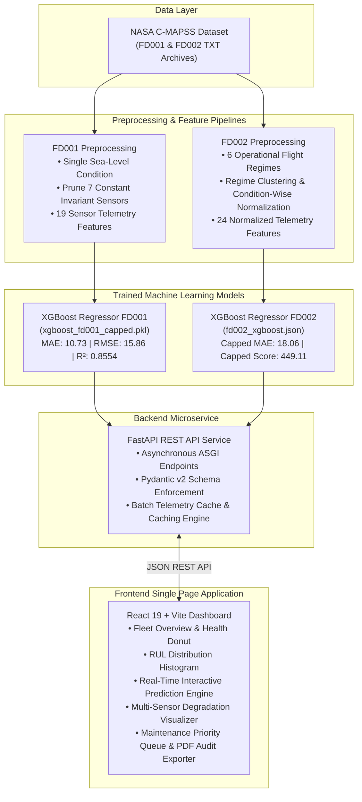

# AuroPulseAI — AI-Powered Predictive Maintenance System Using XGBoost

<p align="center">
  <strong>Monitor. Predict. Prevent.</strong>
</p>

<p align="center">
  
  
  
  
  
  
</p>

---

## ✈️ Project Overview

**AuroPulseAI** is an enterprise-grade AI predictive maintenance platform designed to estimate the **Remaining Useful Life (RUL)** of commercial aircraft turbofan engines using multivariate time-series sensor telemetry.

By analyzing operational cycles, flight settings, and 21 thermodynamic sensors from the **NASA C-MAPSS** (Commercial Modular Aero-Propulsion System Simulation) benchmark dataset, the system transitions aviation fleet maintenance from reactive component failure or rigid calendar overhaul into intelligent, data-driven prognostics.

---

## 🏛️ System Architecture



---

## 📊 Dual Machine Learning Pipelines

AuroPulseAI maintains **strictly isolated** preprocessing and inference pipelines tailored to operational complexity:

| Feature / Metric | FD001 Pipeline | FD002 Pipeline |
|---|---|---|
| **Operating Conditions** | 1 (Sea Level) | 6 Multi-condition Flight Regimes |
| **Fault Modes** | 1 (HPC Degradation) | 1 (HPC Degradation) |
| **Active Sensor Features** | 14 active sensors (prunes 1, 5, 10, 16, 18, 19) | All 21 sensors (condition-wise normalized) |
| **Preprocessing Technique** | Invariant sensor filtering + 125 cycle target capping | Regime clustering + condition mean/std scaling |
| **Model Format** | Serialized Joblib (`.pkl`) | Native XGBoost JSON (`.json`) |
| **Validation MAE** | **10.73 cycles** | **18.06 cycles** (Capped Test) |
| **NASA Score** | Benchmark standard | **449.11** (Capped) |

---

## 🚀 Quickstart — Local Setup

### Prerequisites
* **Python 3.10+** (Python 3.11 or 3.12 recommended)
* **Node.js 18+** & `npm`

### 1. Clone the Repository
```bash
git clone https://github.com/your-username/AuroPulseAI.git
cd AuroPulseAI
```

### 2. Backend Setup (FastAPI + XGBoost)
```bash
# Create and activate virtual environment
python -m venv .venv

# Windows:
.venv\Scripts\activate
# Linux/macOS:
# source .venv/bin/activate

# Install backend dependencies
pip install -r requirements.txt

# Start the FastAPI server with hot-reload
uvicorn app.main:app --host 127.0.0.1 --port 8000 --reload
```
* Backend API documentation will be available at: **http://127.0.0.1:8000/docs**
* Health check endpoint: **http://127.0.0.1:8000/health**

### 3. Frontend Setup (React 19 + Vite)
```bash
# Open a new terminal tab and navigate to frontend
cd frontend

# Install dependencies
npm install

# Start the Vite development server
npm run dev
```
* Open your browser at: **http://127.0.0.1:5173**

---

## ☁️ Deployment Guide

### Deploying the Backend to Railway

Railway provides persistent container memory ideal for keeping trained XGBoost models loaded in RAM without cold starts.

1. **Push your code to GitHub** (see Git steps below).
2. Go to [Railway.app](https://railway.app/) and click **New Project** → **Deploy from GitHub repo**.
3. Select this repository.
4. Railway will automatically detect `runtime.txt`, `Procfile`, and `requirements.txt`.
5. Once deployed, Railway provides a public URL (e.g. `https://auropulse-api.up.railway.app`).

### Deploying the Frontend to Vercel or Netlify

1. In `frontend/.env.production` (or project settings in Vercel/Netlify), set:
   ```env
   VITE_API_BASE_URL=https://your-backend-name.up.railway.app
   ```
2. Build command: `npm run build`
3. Output directory: `dist`

---

## 🛠️ API Reference

| Endpoint | Method | Description |
|---|---|---|
| `/health` | `GET` | Service liveness probe and active dataset status |
| `/datasets` | `GET` | Available dataset specifications and telemetry metadata |
| `/overview/{dataset}` | `GET` | Fleet KPIs, health distribution, RUL histogram, recent alerts |
| `/engines/{dataset}` | `GET` | List of engines with predicted RUL, cycle counts, and priority |
| `/sensors/{dataset}/{id}` | `GET` | Complete multi-sensor time series for a single engine unit |
| `/predict/{dataset}` | `POST` | Real-time RUL inference for custom/populated sensor telemetry |
| `/metrics/{dataset}` | `GET` | Model evaluation statistics (MAE, RMSE, NASA Score) |
| `/reports/figures` | `GET` | High-resolution EDA and prognostic figures gallery |

---

## 📖 Citation & References

```bibtex
@inproceedings{saxena2008damage,
  author    = {Saxena, Abhinav and Goebel, Kai and Simon, Donald and Eklund, Neil},
  title     = {Damage Propagation Modeling for Aircraft Engine Run-to-Failure Simulation},
  booktitle = {Proceedings of the 1st International Conference on Prognostics and Health Management (PHM08)},
  year      = {2008},
  address   = {Denver, CO}
}
```
* **Dataset**: NASA Prognostics Center of Excellence (PCoE) Turbofan Engine Degradation Simulation Dataset.

---

## 📄 License
This project is licensed under the Apache 2.0 / MIT License.
